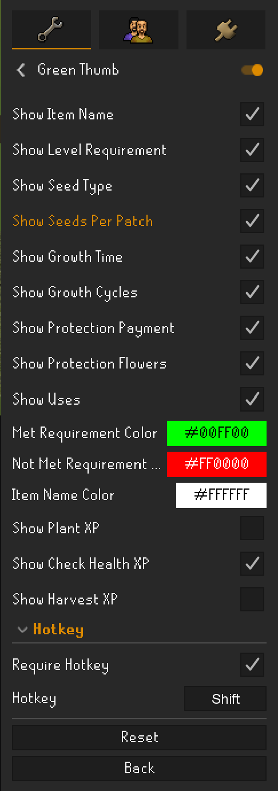

# Green Thumb  
This plugin shows information about various crops such as:
* Level required to plant the crop
* Patch type to plant the crop in
* Number of seeds required to plant a patch with the crop
* Average growth time for the crop
* Payment required for a farmer to protect the crop
* Flower that protects the crop (allotments only)
* Uses for the grown crop

## Hotkey
Turn on **Require Hotkey** to hide the tooltip until you want it. Hovering a seed shows nothing; hold the
configured **Hotkey** (Shift by default) while hovering to show the tooltip. Click the Hotkey button and press
any key to change it.

